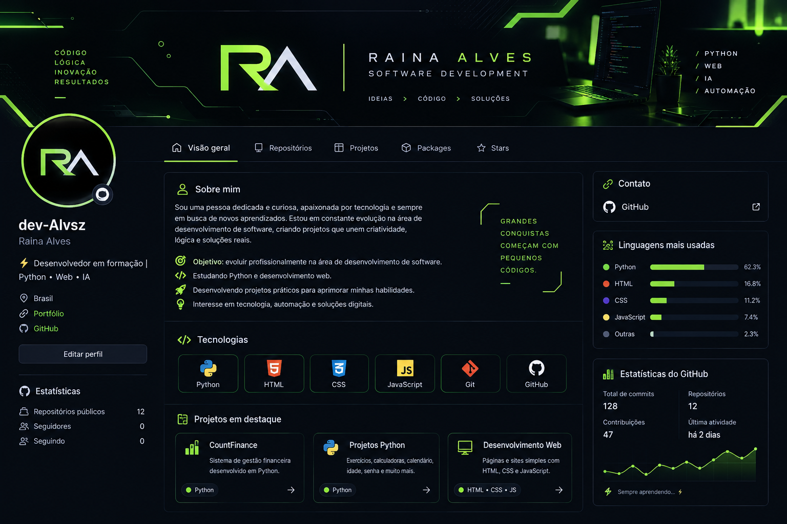

  

# RA | Desenvolvimento de Software

### Desenvolvedora em formação • Python • Desenvolvimento Web

Transformando ideias em soluções digitais por meio da programação, com foco em desenvolvimento de software, automação e inovação tecnológica.

---

### `// SOBRE MIM`

- 🎯 Objetivo: evoluir profissionalmente na área de desenvolvimento de software.
- 💻 Estudando Python e desenvolvimento web.
- 🚀 Desenvolvendo projetos práticos para aprimorar minhas habilidades.
- 🌐 Interesse em tecnologia, automação e soluções digitais.

### `// TECNOLOGIAS`

### `// PROJETOS EM DESTAQUE`

- **CountFinance** — projeto de gestão financeira desenvolvido em Python.
- **Projetos Python** — exercícios de lógica, calculadoras, calendário e outros programas.
- **Desenvolvimento Web** — criação de páginas com HTML e CSS.

### `// CONECTE-SE`

---

Aprendizado contínuo. Código, criatividade e evolução.
